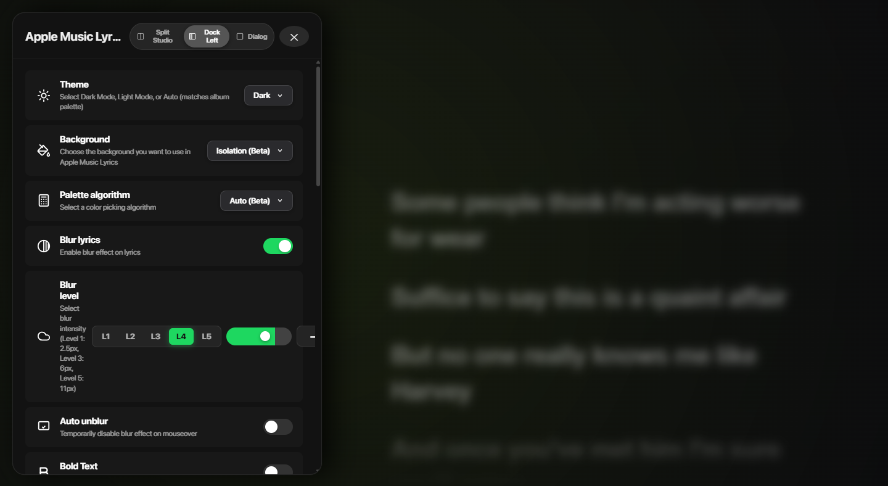
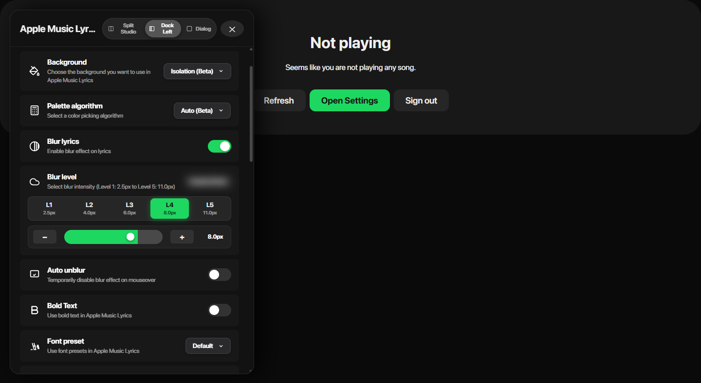

# Blur Settings Side View (Docked Left) Fix

### Problem Identified
In the side view (Dock Left, 500px drawer width):
1. **Squashed Text**: The "Blur level" label and description (`leftCol`) were being crushed to ~42px width because `rightCol` was given `flex-shrink: 0` without a width constraint. Every word in the title and description wrapped onto a single vertical column.
2. **Horizontal Overflow & Clipped Controls**: The blur controls (`L1-L5` segmented buttons, range slider, stepper buttons, and preview swatch) totaled ~589px in horizontal width. In the 450px card width, the controls overflowed by nearly 200px to the right, clipping the `−` button and completely cutting off the `+` button and the live `Blur Sample` swatch.
3. **Decoupled Badge & Live Swatch**: The blur px badge was tied directly to `blurPx` (which became `0.0px` when blur was disabled, causing the slider to show Level 4 while the badge said `0.0px`).

---

### Solution Implemented
1. **Full-Width Card Architecture (`.settingCardRow`)**:
   - Converted the Blur Level row into a vertical stack layout with a dedicated header and body.
   - **Header (`.settingCardHeader`)**: Contains the icon, full-width title ("Blur level"), and description ("Select blur intensity (Level 1: 2.5px to Level 5: 11.0px)") on the left with plenty of room (263px width), and the live blurred preview swatch on the right.
   - **Segmented Buttons (`.segmentedSelector`)**: 5 evenly spaced pill buttons (`L1 2.5px` through `L5 11.0px`), each taking `flex: 1` across the full card width.
   - **Slider & Precision Steppers (`.blurSliderStepperRow`)**: The `−` stepper, smooth range slider, `+` stepper, and tabular `8.0px` badge are placed on their own dedicated row, spanning 100% width with 0px horizontal overflow.
2. **Master Toggle State Dimming**:
   - When "Blur lyrics" is toggled OFF, the Blur level card dims gracefully (`opacity: 0.45; pointer-events: none;`) and the swatch displays "Blur Off". When toggled ON, it illuminates and displays the active live blurred preview.
3. **Open Settings on Not Playing**:
   - Added an "Open Settings" button on the `<NotPlaying />` screen so settings can be opened and customized even when Spotify playback is paused.

---

### Before vs After Comparison

````carousel

<!-- slide -->

````
