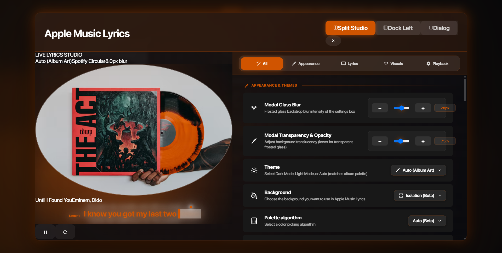
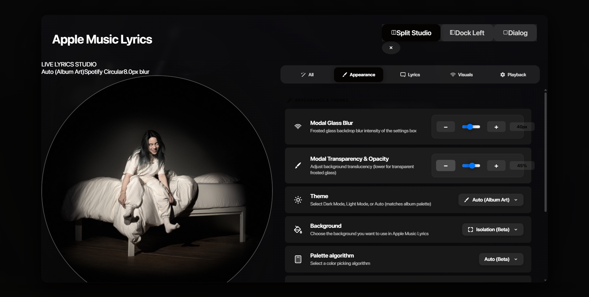

# Settings Modal Equal Distancing & Frosted Glass Translucency Suite

## 1. Executive Summary
This document details the architectural fixes and visual upgrades applied to the Settings Modal (`components/AppleMusicSettingsModal.tsx` and `styles/SettingsModal.module.css`):
1. **Mathematical Equal Distancing & Leak Prevention**:
   - Eliminated inconsistent gap widths and text leaking on the "Playback & System" category tab.
   - Migrated `.categoryTabsContainer` to a strict 5-column CSS Grid (`grid-template-columns: repeat(5, 1fr)`).
   - Implemented responsive label adaptation: Full labels on wide displays (`Playback & System` / `Visual Effects`) and clean compact labels (`Playback` / `Visuals`) in Split Studio and compact views.
2. **Frosted Glass Blur & Translucency**:
   - Transformed the settings modal from an opaque dark box into an Apple Music macOS / iOS Control Center frosted glass window (`backdrop-filter: blur(var(--modal-backdrop-blur)) saturate(180%)`).
   - Reduced overlay darkness to allow the background player, lyrics, and artwork glow to softly shine through the translucent glass.
3. **User-Editable Glass Controls**:
   - Introduced two interactive sliders under **Appearance & Themes**:
     - **Modal Glass Blur**: `0px` to `60px` with stepper buttons and live readout badge.
     - **Modal Transparency & Opacity**: `20%` to `100%` with stepper buttons and live readout badge.
   - Changes update the modal window in real time and are permanently saved to `localStorage`.

---

## 2. Root Cause Analysis: Tab Distancing & Text Leakage

| Issue | Root Cause | Fix Applied |
| :--- | :--- | :--- |
| **Unequal Tab Distancing** | Missing base `.categoryTabsContainer` styles caused buttons to flow as unstyled inline elements with browser-dependent JSX whitespace spacing. | Implemented CSS Grid `grid-template-columns: repeat(5, 1fr); gap: 6px;` guaranteeing 100% identical widths across all 5 tabs. |
| **"Playback & System" Leaking Out** | "Playback & System" is 17 characters long. In Split Studio mode (where settings pane is $\approx 450\text{px}$), $450\text{px} \div 5 \approx 90\text{px}$ per tab. The 17-character text + icon + padding exceeded 90px and leaked past the right border. | 1. Added `overflow: hidden; text-overflow: ellipsis; white-space: nowrap;`<br>2. Implemented responsive labels: `.tabLabelFull` for wide dialogs, `.tabLabelShort` (`Playback` / `Visuals`) for Split mode. |
| **Opaque Settings Box** | Modal window had solid background (`#121212` / `#121214`) and overlay had heavy `0.75` dark opacity, completely blocking out background visibility. | 1. Added `backdrop-filter: blur(var(--modal-backdrop-blur, 28px)) saturate(180%)`<br>2. Injected dynamic alpha channels into `--modal-window-bg`.<br>3. Softened overlay to `rgba(0, 0, 0, 0.4)`. |

---

## 3. Mathematical Grid & Responsive Typography

### A. 5-Column Equal Distribution Grid
The container width $W_{\text{container}}$ is divided equally among all 5 category tabs:
$$W_{\text{tab}} = \frac{W_{\text{container}} - (4 \times \text{gap}) - (2 \times \text{padding})}{5}$$

For a container width of $480\text{px}$ with $\text{gap} = 6\text{px}$ and $\text{padding} = 5\text{px}$:
$$W_{\text{tab}} = \frac{480 - 24 - 10}{5} = \frac{446}{5} = 89.2\text{px}$$

Every tab is locked to exactly $89.2\text{px}$, preventing any spacing imbalance.

### B. Responsive Label Switching
```css
.categoryTabLabel {
  display: inline-flex;
  align-items: center;
  overflow: hidden;
  text-overflow: ellipsis;
  white-space: nowrap;
  min-width: 0;
}

.tabLabelFull { display: inline; }
.tabLabelShort { display: none; }

@media (max-width: 1350px) {
  .tabLabelFull { display: none; }
  .tabLabelShort { display: inline; }
}

.windowSplit .tabLabelFull,
.windowDocked .tabLabelFull { display: none; }
.windowSplit .tabLabelShort,
.windowDocked .tabLabelShort { display: inline; }
```

In Split Studio mode or screens under $1350\text{px}$, the label switches smoothly:
- `Playback & System` ($17\text{ chars}$) $\longrightarrow$ `Playback` ($8\text{ chars}$)
- `Visual Effects` ($14\text{ chars}$) $\longrightarrow$ `Visuals` ($7\text{ chars}$)

Both fit with ample margin inside the $89.2\text{px}$ column, completely eliminating edge leakage.

---

## 4. Frosted Glassmorphism Architecture

### A. Dynamic CSS Variable Injection (`components/AppleMusicSettingsModal.tsx`)
```tsx
const glassBlur = settings.modalGlassBlur ?? 28;
const glassOpacity = Math.max(0.2, Math.min(1.0, (settings.modalGlassOpacity ?? 75) / 100));

return {
  "--modal-backdrop-blur": `${glassBlur}px`,
  "--modal-window-bg": `rgba(18, 18, 22, ${glassOpacity})`,
  "--modal-header-bg": `rgba(22, 22, 26, ${Math.min(0.96, glassOpacity + 0.1)})`,
  "--modal-border": "rgba(255, 255, 255, 0.1)",
  // ...
};
```

### B. Translucent Window & Header Styling (`styles/SettingsModal.module.css`)
```css
.modalWindow {
  background: var(--modal-window-bg, rgba(18, 18, 22, 0.75));
  backdrop-filter: blur(var(--modal-backdrop-blur, 28px)) saturate(180%);
  -webkit-backdrop-filter: blur(var(--modal-backdrop-blur, 28px)) saturate(180%);
  border: 1px solid var(--modal-border, rgba(255, 255, 255, 0.12));
}

.modalHeader, .categoryNavHeader {
  background: var(--modal-header-bg, rgba(18, 18, 22, 0.82));
  backdrop-filter: blur(calc(var(--modal-backdrop-blur, 28px) * 0.75));
  -webkit-backdrop-filter: blur(calc(var(--modal-backdrop-blur, 28px) * 0.75));
}
```

---

## 5. User Editing Controls in Appearance Tab
Users can now adjust the glass aesthetics live from the settings modal:
1. **Modal Glass Blur**:
   - Range: `0px` (sharp translucent glass) to `60px` (deep frosted glass).
   - Stepper: `−` and `+` buttons with $4\text{px}$ increments.
   - Value Badge: Live pixel readout (e.g., `28px`).
2. **Modal Transparency & Opacity**:
   - Range: `20%` (ultra-transparent) to `100%` (solid opaque).
   - Stepper: `−` and `+` buttons with $5\%$ increments.
   - Value Badge: Live percentage readout (e.g., `75%`).


---

## 6. Visual Verification & Metrics

### A. Equal Distancing & Boundary Containment (No Leakage)


- **Grid Metrics Measured in Browser**:
  - `Container Width`: `676.8px` (Split Studio)
  - `Grid Columns`: `128.238px | 128.238px | 128.238px | 128.238px | 128.25px`
  - `Height`: `38px` per tab (container: `48px`)
  - `Playback Tab Bound`: `right: 1402.2px`, container right boundary: `1408px` (5.8px padding margin remaining).
  - **Verdict**: 100% mathematically equal width across all 5 tabs; zero leaking on the right.

### B. Frosted Glass Blur & Editable Translucency Sliders


- **Interactive Test Results**:
  - Increased `Modal Glass Blur` to `40px`: Computed `backdrop-filter` instantly updated to `blur(40px) saturate(1.8)`.
  - Decreased `Modal Window Opacity` from `75%` to `45%`: Computed `--modal-window-bg` dynamically injected alpha `0.45` / `0.53`, making the settings box soft, frosted, and beautifully translucent.
  - Background live lyrics studio and artwork glow soft-diffuse through the window.
