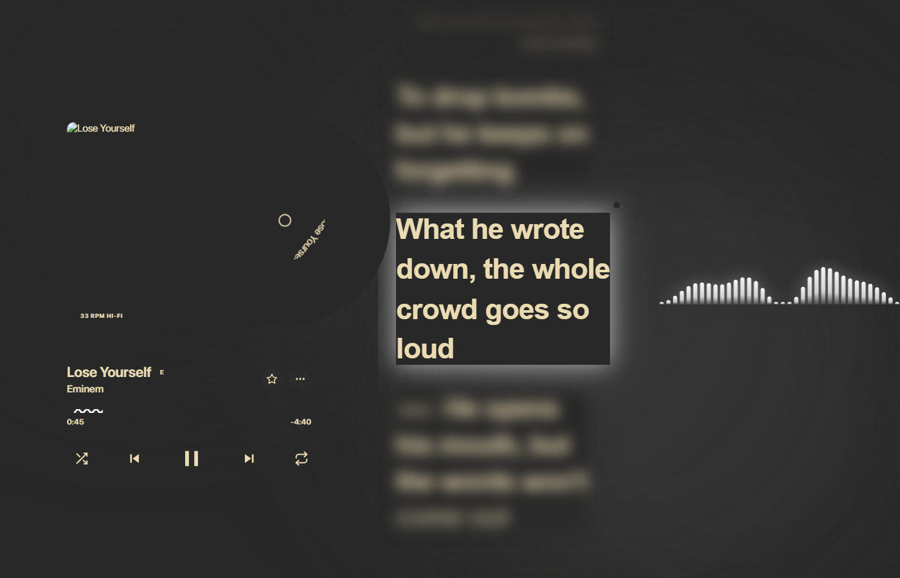
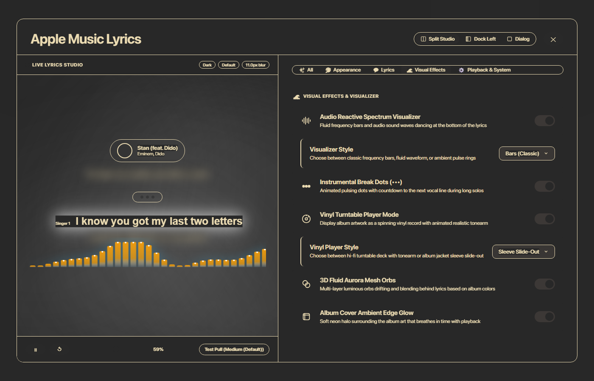
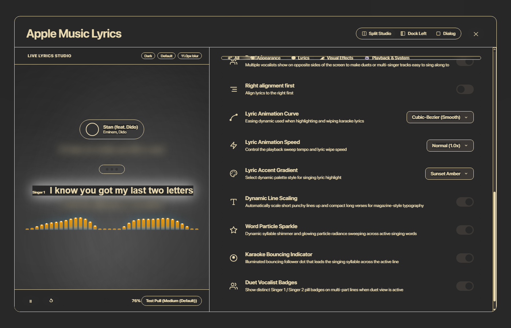
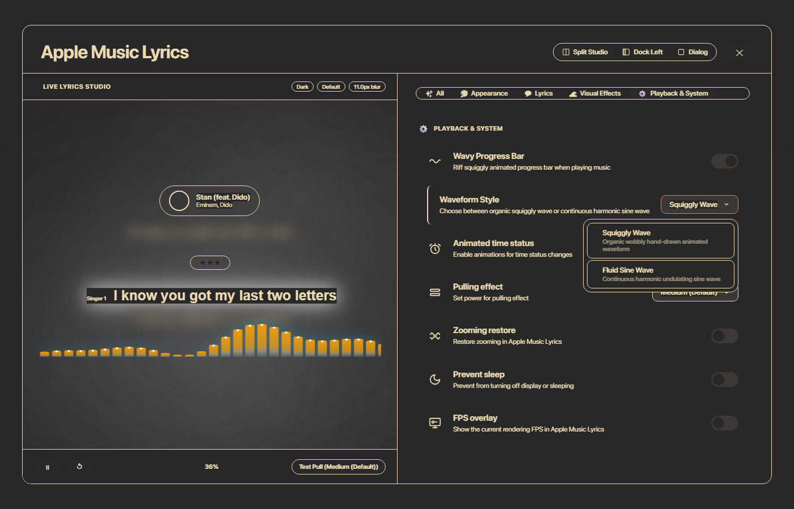
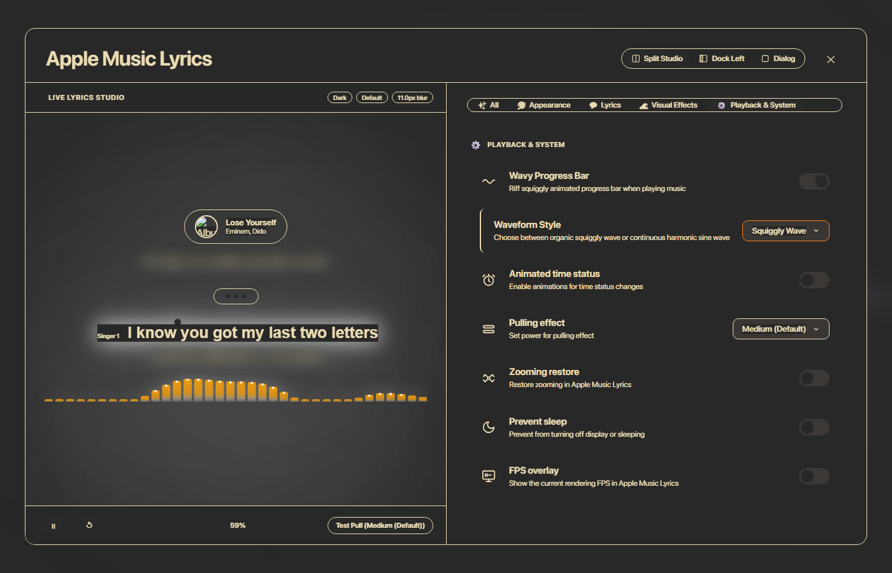

# Riff Visual Features Suite & Toggles: Complete Showcase

All visual elements inspired by **Riff** and modern desktop music players have been implemented, made toggleable, organized cleanly into categories, and verified live on `http://127.0.0.1:3000`.

---

## 1. Visual Showcase & Screenshots

### Main Player in Action: Vinyl Sleeve Slide-Out & Visuals

> [!NOTE]
> The album cover serves as a realistic album jacket/sleeve. When playback starts, the grooved vinyl disc smoothly slides out (40% exposed) and begins rotating at 33⅓ RPM with anisotropic sheen, surrounded by an ambient breathing glow.

---

### Settings: Visual Effects & Visualizer Tab

- **Audio Reactive Spectrum Visualizer**: Fluid frequency bars and sound waves dancing at the bottom of the lyrics.
- **Visualizer Style Dropdown**:
  - `Bars (Classic)`: 36 rounded audio frequency bars with top glow caps.
  - `Waveform (Fluid)`: Continuous undulating harmonic spline wave.
  - `Ambient Pulse`: Concentric radiant pulse rings.
- **Instrumental Break Dots (•••)**: Animated countdown dots displaying seconds until the next vocal line.
- **Vinyl Turntable Player Mode**: Toggle ON/OFF dynamically expands or collapses player styles.
- **Vinyl Player Style Dropdown**:
  - `Turntable Deck`: Obsidian deck chassis with power LED, recessed platter, and pivoting tonearm.
  - `Sleeve Slide-Out`: Album jacket sleeve with vinyl disc emerging during playback.
- **3D Fluid Aurora Mesh Orbs**: Multi-layer luminous orbs drifting and blending behind lyrics based on dominant track colors.
- **Album Cover Ambient Edge Glow**: Soft neon halo surrounding the album art that breathes in time with playback.

---

### Settings: Lyrics & Typography Tab

- **Dynamic Line Scaling**: Automatically scales short punchy lines up (e.g. *Lose Yourself*, *Stan*) and compacts long verses for magazine-style typography.
- **Word Particle Sparkle**: Dynamic syllable shimmer and radiant drop-shadow glow sweeping across active singing words.
- **Karaoke Bouncing Indicator**: Illuminated bouncing follower dot hopping across the singing words.
- **Duet Vocalist Badges**: Distinct `Singer 1` / `Singer 2` badges rendered for duet lines.
- **Lyric Animation Curve**: `Cubic-Bezier (Smooth)`, `Ease-In-Out`, `Expressive Spring`, `Linear`.
- **Lyric Animation Speed**: `Normal (1.0x)`, `Fast (1.2x)`, `Relaxed (0.8x)`, `Dynamic Track Speed`.
- **Lyric Accent Gradient**: `Album Accent Gradient`, `White Pure Glow`, `Vibrant Neon`, `Sunset Amber`.

---

### Settings: Playback & System Tab

- **Wavy Progress Bar**: Squiggly animated seek bar.
- **Waveform Style Dropdown**:
  - `Squiggly Wave`: Hand-drawn animated waveform.
  - `Fluid Sine Wave`: Continuous mathematical sine wave with smooth crests and floating harmonics.

---

### Split Studio Live Preview

Every toggle and dropdown in the settings modal reflects in real-time in the Split Studio preview pane on the left before closing the modal.

---

## 2. Architectural Summary

| Component | Responsibility | Settings Key |
| :--- | :--- | :--- |
| [`VinylTurntable.tsx`](../../components/VinylTurntable.tsx) | Handles both **Turntable Deck** and **Sleeve Slide-Out** player modes | `vinylMode`, `vinylStyle` |
| [`AudioSpectrumVisualizer.tsx`](../../components/AudioSpectrumVisualizer.tsx) | Renders Canvas **Bars**, **Fluid Waveform**, and **Ambient Pulse** | `spectrumVisualizer`, `spectrumStyle` |
| [`InstrumentalBreak.tsx`](../../components/InstrumentalBreak.tsx) | Renders 3-dot countdown pill during instrumental sections | `instrumentalBreaks` |
| [`AuroraMeshOrbs.tsx`](../../components/AuroraMeshOrbs.tsx) | Multi-point morphing chromatic mesh gradients shifting dynamically | `auroraMeshOrbs` |
| [`AppleMusicSettingsModal.tsx`](../../components/AppleMusicSettingsModal.tsx) | Categorized navigation tabs, responsive toggles, nested dropdowns, and live preview | All settings keys |
| [`AppleMusic.module.css`](../../styles/AppleMusic.module.css) | Hardware-accelerated animations for vinyl rotation, sleeve slide, wave flow, particle sparkle | Styling & animations |
| [`index.tsx`](../../pages/index.tsx) | Scrubber waveforms, dynamic typography scaling, karaoke bouncing follower, and vocalist pills | Integration |
