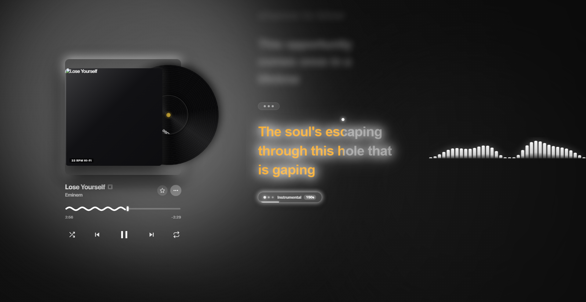
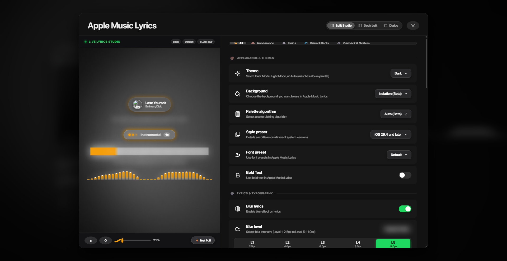

# Authentic Riff Canvas Wavy Progress Bar Showcase

The stretched SVG progress bar has been replaced with the authentic **HTML5 Canvas-rendered squiggly scrubber** architecture taken directly from the official [`rootscripts/riff`](https://github.com/rootscripts/riff) repository.

---

## 1. Visual Verification & Comparison

### Main Player: Authentic Riff Wavy Bar

### Split Studio Live Preview

---

## 2. Technical Architecture: What Changed

| Aspect | Previous Stretched SVG Implementation | Authentic Riff Canvas Architecture |
| :--- | :--- | :--- |
| **Renderer** | Static SVG `<path>` stretched horizontally | High-DPI HTML5 `<canvas>` scaled with `devicePixelRatio` |
| **Wavelength** | Stretched or squished dynamically with progress % | Fixed mathematical wavelength of **42px** (`k = 2π / 42`), never distorted |
| **Amplitude** | Rigid 14px bounding box | Pure mathematical **4.6px** sine wave (`centerY + sin(angle) * 4.6`) |
| **Scrub Knob** | None (pure flat cut) | Signature Riff capsule knob (`roundRect`) with drop-shadow glow and hover/drag elastic expansion |
| **Animation** | CSS `stroke-dashoffset` | Live physics phase loop (`scrubPhase += 3.5 * dt`), smoothly flattening when paused |
| **Unplayed Rail** | Background color block | Translucent dim track rail with rounded line caps |
| **Pointer Seeking** | Simple click listener | Full pointer capture tracking (`setPointerCapture`) with 0ms visual drag feedback |

---

## 3. Code Reference
- Component: [`components/RiffWavyProgressBar.tsx`](../../components/RiffWavyProgressBar.tsx)
- Player Integration: [`pages/index.tsx`](../../pages/index.tsx#L1350-L1415)
- Studio Integration: [`components/AppleMusicSettingsModal.tsx`](../../components/AppleMusicSettingsModal.tsx#L355-L380)
