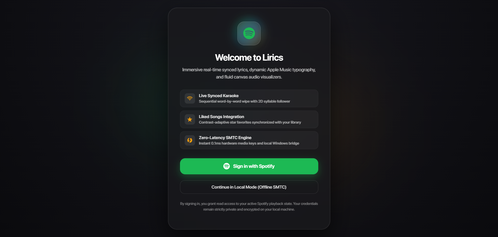
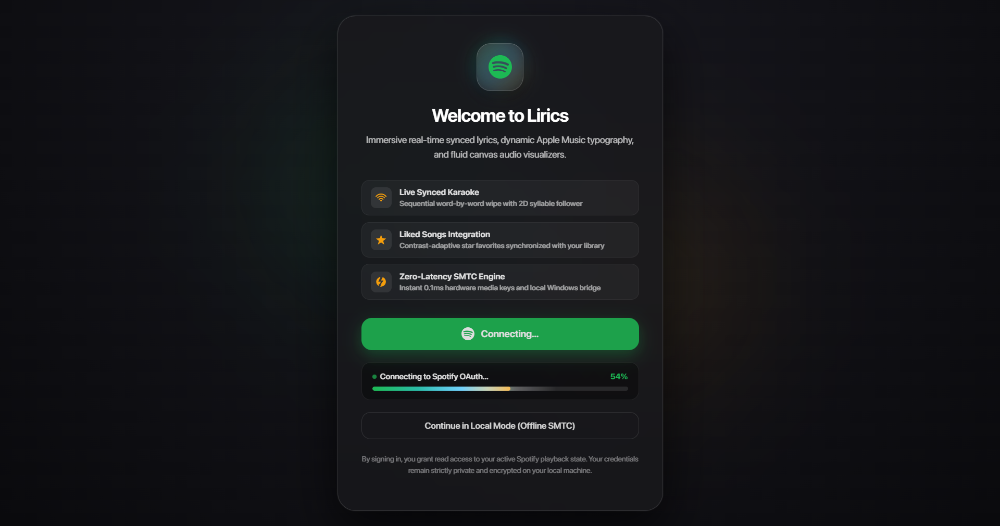
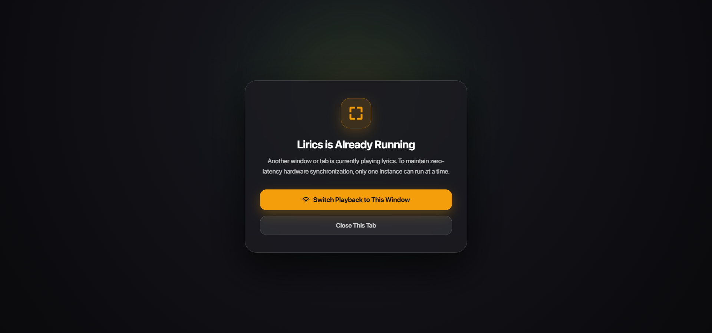

# Single-Instance Enforcement & Redesigned In-App Sign-In Suite

## 1. Executive Summary
This document covers the architectural implementation of:
1. **Universal Single-Instance Lock**: Prevents multiple simultaneous instances or browser tabs of Lirics from running concurrently.
2. **Redesigned In-App Sign-In Experience**: Replaced the legacy 14-line plain dialog with a dark glassmorphic Apple Music & Gruvbox interface.
3. **Animated Redirection Progress Engine**: Visual loading progress bar counting up from $0\% \to 100\%$ with multi-stage status indicators upon initiating authentication.

---

## 2. Universal Single-Instance Enforcement Architecture

### A. Web / Browser Layer ([`components/SingleInstanceGuard.tsx`](../../components/SingleInstanceGuard.tsx))
To maintain zero-latency hardware synchronization and avoid conflicting polling loops or audio desync:
- **Tab Identity**: Each browser session generates an ephemeral `inst_<random>_<timestamp>` identifier.
- **Heartbeat & Storage Lock**:
  - The active tab writes to `localStorage` (`lirics_active_instance_id` and `lirics_instance_heartbeat`) every $1,000\text{ms}$.
  - Stale timeout is enforced at $3,000\text{ms}$. If a tab crashes or is forcefully closed without a clean release, waiting tabs automatically reclaim the lock.
- **Sub-Millisecond Inter-Tab Communication**:
  - Leverages `BroadcastChannel("lirics_single_instance_lock")` for cross-tab coordination.
  - Messages include `CLAIM_ACTIVE`, `RELEASE_ACTIVE`, and graceful handover.
- **Blocked Overlay Screen**:
  - Any subsequent tab or window that opens while an active instance is running displays a sleek frosted glass overlay:
    - Headline: **"Lirics is Already Running"**
    - Action: **"Switch Playback to This Window"** (triggers immediate seamless takeover).
    - Action: **"Close This Tab"** (`window.close()`).

### B. OS Process & Desktop Launchers
- **Native Launcher ([`run-desktop.ps1`](../../scripts/archive/run-desktop.ps1))**:
  - Checks `Get-Process -Name "app", "Lirics"` before launching. If an existing process is found, activates the existing window via `Wscript.Shell.AppActivate` and terminates the launcher with exit code 0.
- **Kiosk Launcher ([`launch-kiosk.ps1`](../../scripts/archive/launch-kiosk.ps1))**:
  - Inspects running Chrome processes for the dedicated `.chrome-kiosk` data directory. Brings existing kiosk windows to the foreground instead of spawning duplicate instances.

---

## 3. Redesigned In-App Login Experience

### Visual & Architectural Upgrades ([`components/Signin.tsx`](../../components/Signin.tsx))
- **Aesthetic**: Radial ambient gradient with 3 floating animated blur orbs (`rgba(29, 185, 84, 0.16)`, `rgba(245, 158, 11, 0.14)`, `rgba(56, 189, 248, 0.12)`) and a frosted glass card (`backdrop-filter: blur(45px)`).
- **Brand Identity**: Spotify vector icon enclosed in a glowing pulse ring (`animation: logoPulse 4s ease-in-out infinite`).
- **Feature Showcase**: 3 structured cards displaying Live Synced Karaoke, Liked Songs Integration, and Zero-Latency SMTC Engine.
- **Dedicated Route**: Registered at [`/auth/signin`](../../pages/auth/signin.tsx) and wired directly to NextAuth's `pages: { signIn: "/auth/signin" }`.

---

## 4. Animated Redirection Progress Engine

When the user clicks **Sign in with Spotify**:
1. The button enters the `isConnecting` state, preventing duplicate clicks.
2. An animated loading progress bar dynamically appears beneath the button:
   - **Visual Styling**: 6px pill track with a glowing multi-color gradient (`#1db954` Spotify green $\to$ `#38bdf8` cyan $\to$ `#f59e0b` gold) and a continuous linear shimmer sweep.
   - **Spring Easing Curve**: Progressive cubic-out curve over $1,350\text{ms}$:
     $$P(t) = 1 - (1 - t)^{2.5}$$
   - **Dynamic Multi-Stage Status**:
     - $0\% - 35\%$: `Preparing secure session...`
     - $35\% - 75\%$: `Connecting to Spotify OAuth...`
     - $75\% - 100\%$: `Redirecting to Spotify...`
3. At $100\%$, triggers NextAuth's `signIn("spotify", { callbackUrl: "/" })` to execute the OAuth redirect.

---

## 5. Visual Verification Screenshots

### A. Redesigned In-App Sign-In Screen

### B. Animated Loading Progress Bar & Live Status Indicator

### C. Universal Single-Instance Concurrency Guard Overlay

