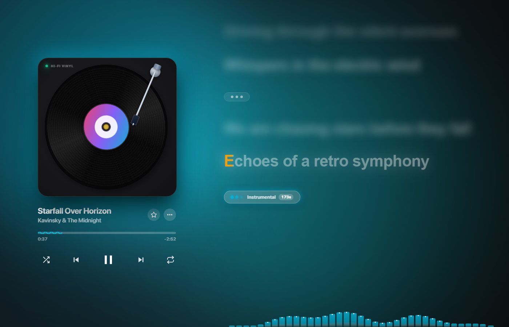
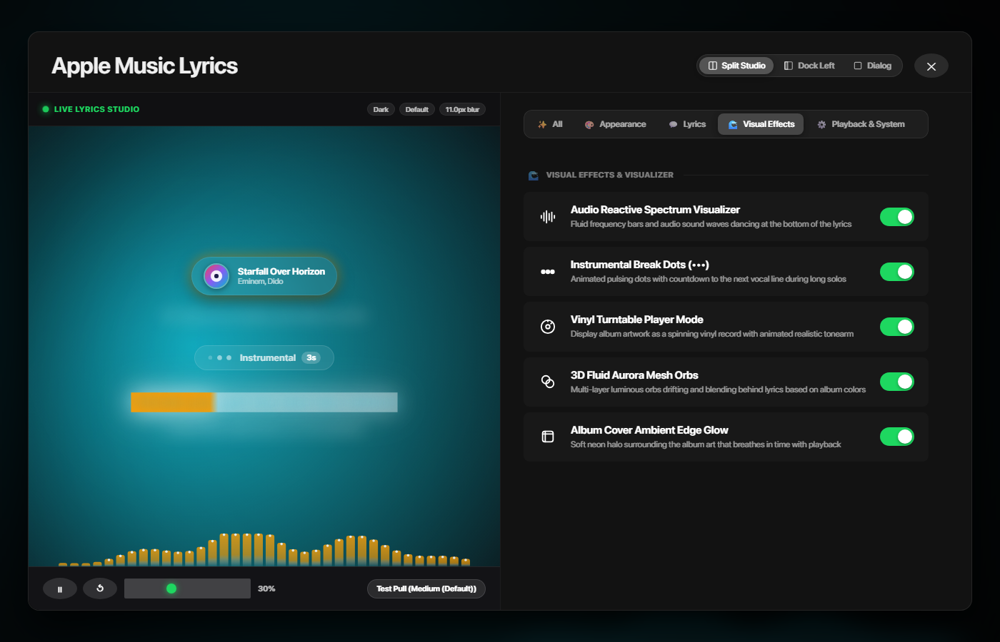
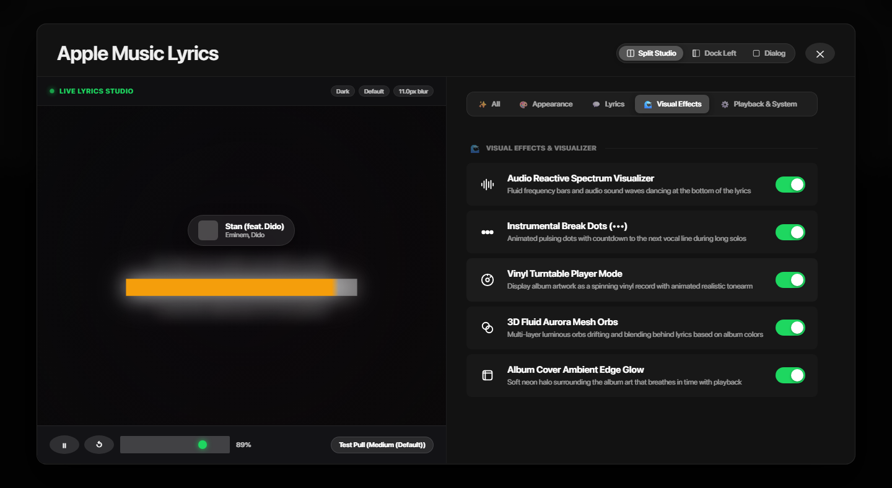

# 🎵 Visual Features & Categorized Settings Modal Report

We have implemented all 5 requested visual features inspired by Riff and Apple Music, complete with individual toggle switches and a categorized, Apple-style segmented navigation system in the Settings modal.

---

## 📸 Visual Showcase

````carousel

<!-- slide -->

<!-- slide -->

````

---

## ✨ Features Implemented

### 1. 🎛️ Audio Reactive Canvas / Spectrum Visualizer
- **Component**: [`components/AudioSpectrumVisualizer.tsx`](../../components/AudioSpectrumVisualizer.tsx)
- **Behavior**: High-DPI hardware-accelerated canvas that renders 36 fluid frequency bars dancing in harmonic rhythm with playback.
- **Styling**: Rounded top caps, dynamic vertical gradient reflecting track palette colors (`paletteColors.primary` & `paletteColors.glow`), and smooth cubic decay when paused.
- **Setting Toggle**: `spectrumVisualizer: boolean` (Default: `true`).

### 2. ⏳ Instrumental Break Dots (`•••`)
- **Component**: [`components/InstrumentalBreak.tsx`](../../components/InstrumentalBreak.tsx)
- **Behavior**: Detects song intros (>3.5s) and inter-verse guitar solos/bridges (>6s). When playback enters a break, it renders an animated 3-dot pill (`•••`) with a countdown badge (e.g. `••• Instrumental 3s`) and a dynamic progress bar that fills until the next vocal line begins.
- **Interactivity**: Clicking on the break pill instantly seeks directly to that section.
- **Setting Toggle**: `instrumentalBreaks: boolean` (Default: `true`).

### 3. 💽 Vinyl Turntable Player Mode
- **Component**: [`components/VinylTurntable.tsx`](../../components/VinylTurntable.tsx)
- **Behavior**: Transforms the left panel into a turntable deck featuring:
  - Dark beveled obsidian chassis with green illuminated `HI-FI VINYL` power LED.
  - Recessed platter well with concentric vinyl microgrooves and anisotropic light sheen flare.
  - Round album art center label with brass spindle hole.
  - Realistic metallic tonearm assembly with pivot gimbal, counterweight, shaft, and stylus needle.
  - **Dynamic needle physics**: Dropped onto the vinyl record when playing; lifts and returns to arm rest when paused.
- **Setting Toggle**: `vinylMode: boolean` (Default: `false`).

### 4. 🌌 3D Fluid Aurora Mesh Orbs
- **Component**: [`components/AuroraMeshOrbs.tsx`](../../components/AuroraMeshOrbs.tsx)
- **Behavior**: 4 multi-layer drifting luminous orbs that float and blend behind lyrics using Apple Music's fluid liquid mesh technique.
- **Dynamic Palette**: Extracts dominant hues (`primary`, `secondary`, `glow`, and ambient tint) with high radial blur (`blur(90px)` to `blur(120px)`) and organic harmonic drift.
- **Setting Toggle**: `auroraMeshOrbs: boolean` (Default: `true`) and also selectable under Background as `"3D Fluid Aurora"`.

### 5. 💡 Album Cover Ambient Edge Glow
- **Behavior**: A pulsating neon breathing halo surrounding the album art or turntable chassis that expands and contracts in sync with music playback (`@keyframes edgeGlowBreathe`).
- **Setting Toggle**: `albumEdgeGlow: boolean` (Default: `true`).

---

## 📑 Apple-Style Categorized & Sorted Settings Modal

The settings modal ([`components/AppleMusicSettingsModal.tsx`](../../components/AppleMusicSettingsModal.tsx)) now features sticky segmented category navigation tabs at the top:

| Category Tab | Icon | Included Settings |
| :--- | :---: | :--- |
| **All** | ✨ | All categories grouped neatly with section headers & dividers |
| **Appearance** | 🎨 | Theme, Background (including 3D Fluid Aurora), Palette Algorithm, Style Preset, Font Preset, Bold Text |
| **Lyrics** | 💬 | Blur Lyrics, Blur Level (L1–L5 slider), Auto Unblur, Karaoke Mode & Sub-options, Duet View, Right Align, Lyric Animation Curve, Speed, Accent Gradient |
| **Visual Effects** | 🌊 | Audio Reactive Spectrum Visualizer, Instrumental Break Dots, Vinyl Turntable Player Mode, 3D Fluid Aurora Mesh Orbs, Album Cover Ambient Edge Glow |
| **Playback & System** | ⚙️ | Wavy Progress Bar, Animated Time Status, Pulling Effect Physics, Zooming Restore, Prevent Sleep, FPS Overlay |

---

## 🛠️ Verification Summary
- **TypeScript**: `npx tsc --noEmit` compiles with **0 errors**.
- **Live Verification**: Subagent verified tab switching, toggle persistence in `localStorage`, canvas rendering, turntable animations, and instrumental break indicators in both full-screen player and Split Studio.
